# CW Open and CWT with TR4W

Based on **The CW Open and TR4W**, Marvin Bloomquist, N5AW (2011). Updated for TR4W by Tom Schaefer, NY4I, November 2026.

This edition keeps Marv's practical approach: configure a small station, learn the messages, and practice before the event. It replaces the older setup procedures with the current application. Screenshots come from the Windows GUI-test VM running **TR4W 5.0.37**. W1AW/TOM and any contacts shown are practice examples, not an operating log. Other platforms and later builds can differ. The [operator guide](https://tr4w.github.io/TR4W-D12/) covers broader station setup.

## 1. Choose the right activity

**CW Open and CWT are different events.** Choosing the wrong contest changes exchange interpretation, not just the CQ text.

| Activity | TR4W choice | Exchange |
| --- | --- | --- |
| CW Open | **CWOps CW Open**; internal name CWOPEN | Sequential serial number and name. |
| CWT | **CWops Test (CWT)**; internal name CWOPS | First name and CWops member number for members; non-members send first name and state, province, or DX country prefix. Call **CQ CWT**. |

CW Open has three independently scored sessions, each starting its serial numbers at 1. Keep a separate log for each. Work a station once per band per session and retain dupes. Score each session from valid QSO points times distinct callsigns worked: working a call on another band can add points without adding another distinct-call multiplier. Consult the [CW Open rules](https://cwops.org/cwops-tests/cw-open/) for the event year, times, categories and submission instructions.

For CWT, use the [CWT rules](https://cwops.org/cwops-tests/) and its own exchange. Merely changing CWO to CWT in a CQ message does not select the right contest.

## 2. Install and create a practice log

Obtain the intended 5.x package from [TR4W-D12 releases](https://github.com/TR4W/TR4W-D12/releases) and follow its installation instructions. Earlier manuals and downloads can describe 4.x; check the version you installed.

Use the installer for normal Windows setup. Copying only an executable leaves out required data, libraries and help files. If Windows flags a download, verify its source and investigate the reported problem before proceeding. Do not disable antivirus as a routine installation step.

Start with a practice log separate from any log you will submit. In **Open configuration file or start a new contest**:

1. Under **Start a new contest**, search for **CW Open**.
2. Select **CWOps CW Open**.
3. Enter your **Callsign** and **MY NAME**. Use the name you will send, not a membership number.
4. Review the category selections, particularly CW mode, operator class and power. The screenshot contains example values, not recommendations for your entry.
5. Choose **OK**. Check that the main title identifies CWOPEN and your callsign.

TR4W keeps your contacts and contest settings together in a log file ending in **.db**. You do not need to edit that file yourself. To continue later, select your log at startup or use **File → Open Log...**. Finish the current contact before switching logs.

Locate the current band/mode, outgoing serial, callsign and exchange fields, log rows, score and operating state. No physical radio is connected in this screenshot; a displayed band does not prove a rig is tuned there.

**Multiplier display:** the tested build labels distinct-call multipliers as Prefixes and also displays an irrelevant Zones row. This UI vocabulary is tracked in [issue #277](https://github.com/TR4W/TR4W-D12/issues/277). One valid practice contact produced the expected one point; no scoring failure was demonstrated. The screenshot is not a certification of every scoring case.

## 3. Learn Preferences

Press **Ctrl+J**. Expand the task groups on the left and select their leaves, or search for a setting by name. Hover over a setting for its help where available.

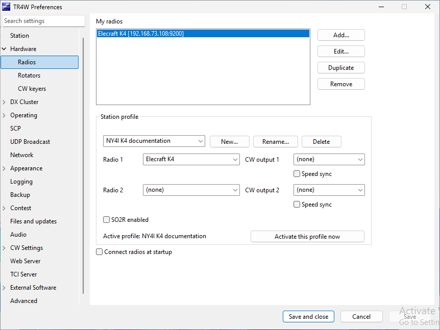

**Save** saves without closing; **Save and close** saves and returns to operating; **Cancel** discards pending changes. Read restart notices rather than assuming every setting applies immediately. The old Save All procedure is not the current Preferences workflow.

Set your station callsign, name and Maidenhead grid to the real operating location. Review the grid when moving the station. Keep practice settings and contacts out of the submitted log.

Use Tab and Shift+Tab to check keyboard navigation. If focus disappears or jumps unexpectedly, record the page and the controls before and after it. Missing explanations and tooltips should be reported; source code should not be required reading for an operator.

## 4. Configure radio control and CW separately

CAT control supplies frequency/mode information. CW keying sends messages. Test these as separate functions.

In **Hardware → Radios**, add a named radio definition. Select the model and its supported serial or network connection. Match serial parameters to the radio; for network control, enter the service address, port and any required credentials. The old guide's K3 values are examples, not universal defaults.

Assign the definition to **Radio 1** in a station profile. Reuse saved definitions instead of re-entering connections for every contest. Select/activate the intended profile, save and follow its connection or restart instructions. Open **Windows → Radio 1** and compare tuning and mode changes against the radio. A visible panel alone does not establish communication.

For the connected example, NY4I supplied an Elecraft K4 at **192.168.73.108**, TCP port **9200**. These are this station's values; substitute your radio's address and CAT service port. Select Elecraft K4, enter the address and port on the Network tab, and save the definition.

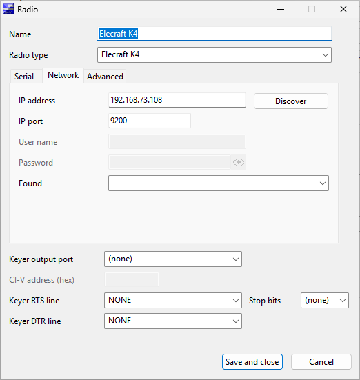

Assign that definition to Radio 1 in a station profile and activate it. Acknowledge the profile-active message, then save and close Preferences. The documentation test activated this profile without restarting TR4W.

The connected display below reports VFO A at 14.020 MHz in CW and VFO B at 14.030 MHz in DATA. The refreshed main window shows 20 CW and the Elecraft K4 name. The test read radio status without changing tuning or sending CW.

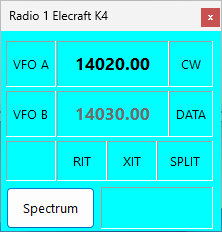

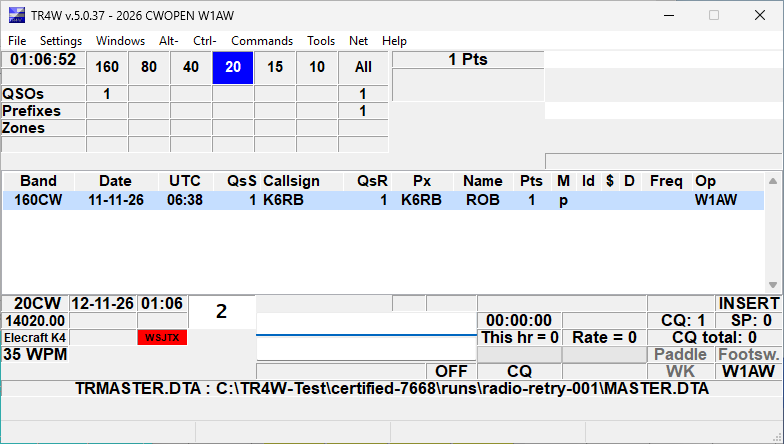

For a WinKeyer, use **Hardware → CW keyers** to add the device, choose its type and COM port, and assign the intended CW output in the profile. Windows Device Manager can help identify a USB device's port. Do not guess a port that belongs to another station device.

Some radio drivers can send CW through CAT. A network connection alone does not establish that capability. Select one intended sending method and verify its routing. With two radios, confirm which radio and keying output are active before introducing advanced switching.

The initial practice fixture has no radio or keyer. The separate connected K4 example verifies status reception only. At the station, use an appropriate safe test arrangement to check short and buffered messages, speed changes, Escape cancellation and radio/output switching. Confirm that stopping a message does not leave the transmitter keyed.

## 5. Program messages for CW Open

Choose **Settings → Program messages** to select CQ, exchange/search-and-pounce, or other messages. **Alt+P** opens the message list for the current context. These are the routes observed in the tested application; an older guide's Tools menu route is stale.

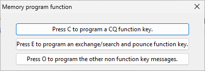

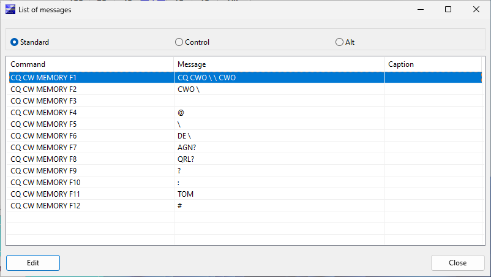

Standard, Control and Alt banks hold the corresponding function-key memories. CQ and exchange/S&P contexts can give the same key different content. Select an entry and choose **Edit**, checking its command name before changing it.

The screenshots show programmed CW Open examples following Marv's D7 guide, with TOM substituted for MARV. They show CWO, not the generic TEST default. Marv's original F1 is **CQ CWO**, your call twice, then **CWO**; F2 is the shorter **CWO** and your call.

**Message** holds the content/action sequence; **Caption** labels the button. Changing a caption does not change what is sent. Use the editor's command list for supported expansions rather than guessing macro names.

| Key or memory | CW Open example | Check |
| --- | --- | --- |
| CQ F1 | `CQ CWO \ \ CWO` | Long CQ; each backslash expands your configured call. |
| CQ F2 | `CWO \` | Short CQ. S&P F2 has a different role. |
| F4 | `@` | Sends the call being worked. |
| F5 | `\` | Sends your station call. |
| F6 | `DE \` | DE and your call. |
| F7 | `AGN?` | Requests a repeat. |
| F8 | `QRL?` | Checks whether the frequency is in use. |
| F9 | `?` | Short repeat request. |
| F11 | `TOM` | Your first name. |
| F12 | `#` | Serial number selected by TR4W. |
| CQ/S&P exchange and repeats | `# TOM` | Replace TOM with your name; verify the serial on repeats. |
| QSL | `73 \ CWO` | Acknowledgment, your call and event. |
| Quick QSL | `TU \` | Short acknowledgment and your call. |

As in Marv's guide, leave S&P F1/F2 and F10 in their special roles; use the same F4–F9/F11/F12 fills in both banks. F3 is blank in these examples. Review **Other messages** too: the normal exchange and repeat memories must match the contest. CW Open does not exchange an RST; do not copy a 5NN exchange from another contest. Leave autosend disabled while learning.

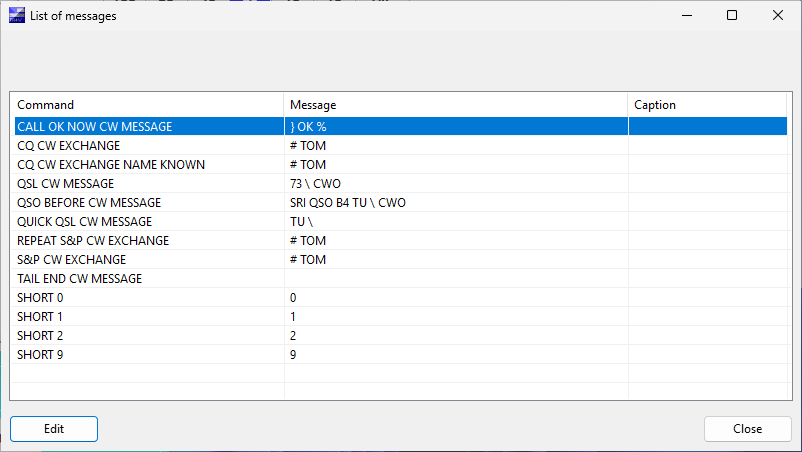

Close TR4W normally and reopen the practice log to check message persistence. The automated editor captures are not an RF/keyer test; the VM does not validate transmitted timing or audio.

### CWT: change the contest and exchange, not just the CQ

The D7 guide is primarily for **CW Open**. Its CQ screenshots use CWO; its final section says to select **CWOPS** and change CWO to CWT for CWT practice. In the current contest picker, choose **CWops Test (CWT)**. The title should identify CWOPS.

For CWT, call **CQ CWT**. Exchange just your **first name and CWops member number**. If you are not a member, send your **first name and state, province, or DX country prefix**. Do not send a sequential CW Open serial or copy the CW Open `# TOM` exchange into this log.

The separate CWT screenshots use a non-member example, **TOM FL**. W1AW/TOM/FL are demonstration values, not a statement about the callsign's operator or membership. In the setup dialog, **MY NAME** is TOM and **MY STATE** is FL; the dialog explains that the second value can instead be a member number.

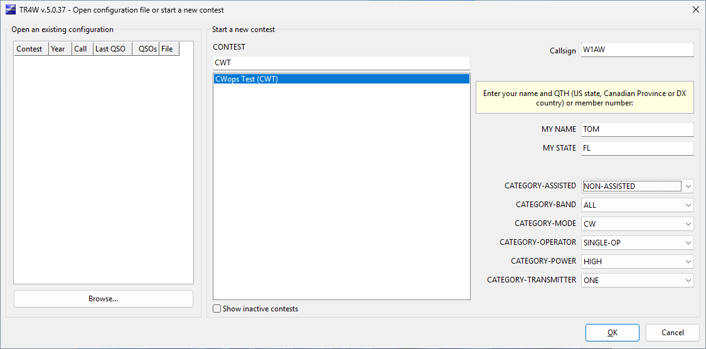

| Memory | CWT example |
| --- | --- |
| CQ F1 | `CQ CWT \ \ CWT` |
| CQ F2 | `CWT \` |
| CQ/S&P exchanges and repeats, non-member | `TOM FL` |
| CQ/S&P exchanges and repeats, member | Your first name followed by your actual CWops member number. |
| QSL | `73 \ CWT` |
| Quick QSL | `TU \` |
| F11/F12 fills | First name / member number or location, rather than a sequential serial. |

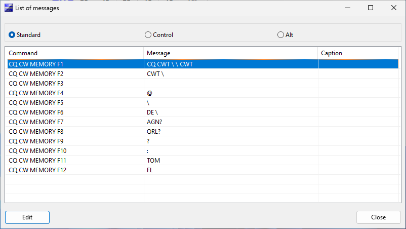

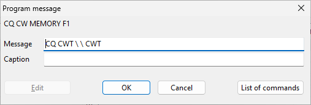

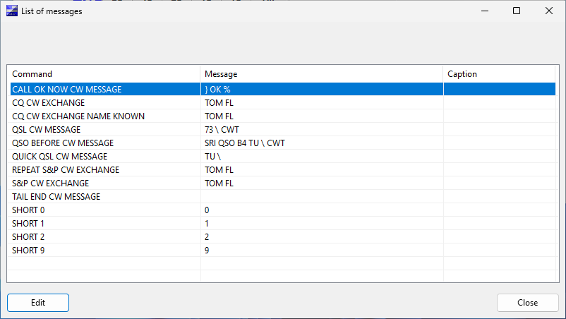

Review both the CQ and S&P banks and the **Other messages** list. Keep the special S&P F1/F2 and F10 roles. Changing only F1 or its caption leaves the normal Enter exchange and repeat memories unchanged.

## 6. Practice contacts and corrections

### Answering a CQ

Select S&P operation and enter the station you hear in the callsign field. Check the dupe indication, then send your call with the S&P message you have verified.

When answered, copy the station's serial and name into the exchange field. For example, a station sending serial 17 and name ROB is recorded with 17 and ROB. Any prefilled name is a suggestion, not proof of what was sent.

Send your serial/name exchange and complete the QSO with the logging action you rehearsed. Check the new row's call, UTC, band/mode, received serial/name and sent serial. **Ctrl+Enter** logs without CW; it still writes an actual contact, so practice in the practice log.

### Calling CQ

Select CQ operation and send your CQ message. Enter the answering station's call, send the exchange, and copy its serial and name into the exchange field. Finish with the acknowledgment/logging action you have tested.

If the other station requests a repeat, verify which message and serial will be sent. Do not assume that a repeat key has the old document's meaning. Check serial-decrement/repeat behavior in the practice log before using it on air.

The precise Enter/function-key sequence depends on the selected message banks and automatic-entry options. Learn one ordinary contact before enabling autosend, automatic CQ-to-S&P switching or advanced two-radio commands. Escape stops active CW; additional effects on entry/mode depend on the operating state and settings.

### Reviewing a QSO

Double-click the intended logged contact to open its editor. For an older contact, use **Alt+L** to search and open the matching QSO. Check callsign and UTC as well as the exchange before saving a correction. **Ctrl+L** opens the log view/edit route.

Retain dupes according to the rules. If practice contacts were logged in the wrong log, stop and identify the affected records before changing anything. Deleting records to improve a displayed score can remove information needed for log checking.

### A no-CW rehearsal in CQ mode

In the isolated VM, the following sequence produced a logged contact without CW output:

1. In the clean CW Open practice log, enter K6RB in the callsign field.
2. Press **Ctrl+Enter** to advance the contact without sending CW.
3. Enter **1 ROB** in the exchange field.
4. Press **Ctrl+Enter** to complete the contact.
5. Verify the new row, received serial 1, name ROB, next outgoing serial 2, and one-point total.

These are test values, not a report of a real contact. In the main logging window, **Ctrl+A invokes keyboard CW**; do not use it as a select-all shortcut for the callsign field. Other text-editing dialogs may handle that key differently.

## 7. Keep the three sessions separate

Use one log for each CW Open session so the contacts and serial numbers stay separate.

1. Create an empty CW Open log, then close TR4W normally.
2. In File Explorer, give that log file a clear name such as **CWOPEN-session-1.db**.
3. Repeat for **CWOPEN-session-2.db** and **CWOPEN-session-3.db**.
4. Before each session, open its log and check the name, zero contacts, starting serial 1, messages and category.

The tested version can suggest the same filename for all three sessions ([issue #276](https://github.com/TR4W/TR4W-D12/issues/276)). If asked to replace an existing log, choose **No**. Keep a backup, and close TR4W before renaming or moving a log. You do not need to manage the supporting files yourself.

## 8. Add useful operating windows

The **Windows** menu offers the band map, dupe sheet, function keys, SCP and radio panels. Start with the main window and add only the displays you need.

For a cluster example, open **DX Cluster → Configure** and add **dxc.nc7j.com:7373**. The documentation test used **NY4I-2** in **Log in as**; use your own callsign. Select **Use this**, save and close Preferences, then choose the named host in the DX Cluster console and Connect. In this test the console had to be reopened to refresh its host choices.

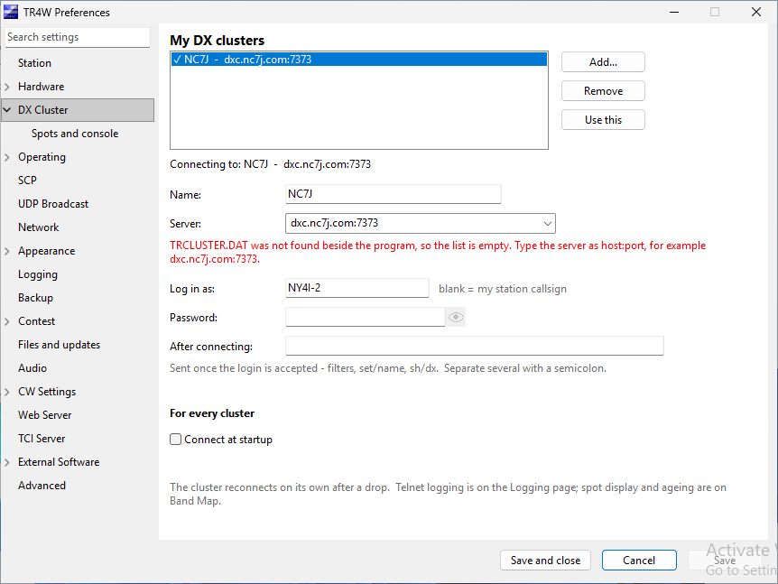

NC7J accepted the login. **SH/50** requests recent spots without selecting or tuning to one. The screenshot shows the received response.

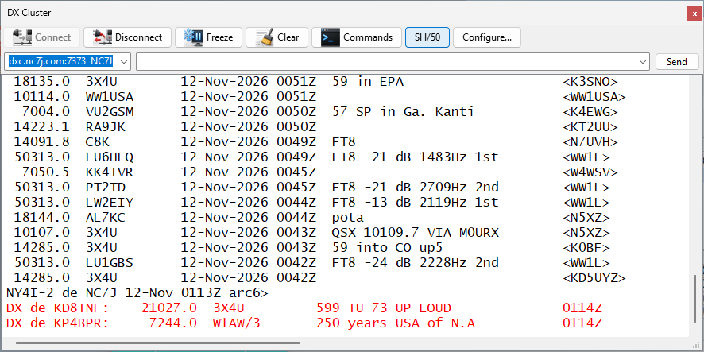

Open **Windows → Band Map** to see received spots. For this example, the right-click options **BAND MAP ALL BANDS** and **BAND MAP ALL MODES** are enabled so spots outside the K4's current band and mode are visible. Turn those options off when you want a view limited to your operating band and mode. An empty map can simply mean that no incoming spots match its filters. No spot was used to tune the K4 during this capture.

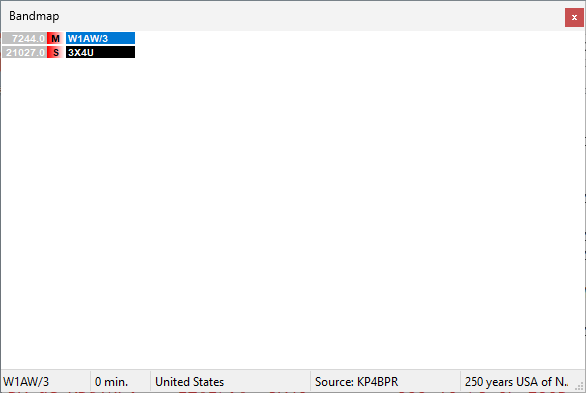

SCP/possible calls help with uncertain copy but do not establish the transmitted call. A band-map spot is not a logged contact. Check tune-from-spot behavior with your radio before relying on it. For CW Open, use the distinct-callsign multiplier rule rather than interpreting a generic zone/country display as the contest's rule.

Choose assistance/category options consistent with the current sponsor rules and how you actually operate.

## 9. Back up, export and submit

Press **Alt+F** to back up your log. Check that the backup completed and keep a copy in another location.

After each CW Open session:

1. Check that you opened the correct session log. Review the contacts, score, station call and category.
2. Use **File → Export → Cabrillo** and inspect the station/category information and QSO lines.
3. Retain a separately named submission file for this session. Follow the sponsor's current session-numbering and filename instructions.
4. Submit through the sponsor's designated route and retain the acknowledgment. Generating a file does not submit it.
5. Export ADIF separately if you want to copy contacts to another logger. Note where TR4W saves the exported file.

For CWT, follow its current score-reporting instructions, not automatically the CW Open submission procedure.

## Before going on air

With transmission safely inhibited, rehearse a complete practice contact. Verify the right log and station identity, correct exchange, band/mode, message banks, serial behavior, cancellation, backup and reopening. Begin the event in its clean session log.

For support, provide version, platform, contest, exact steps and a screenshot. Use the current project support links; this update does not renew personal email/support commitments from the historical article.

## Evidence and review limits

The original is preserved as **TR4W-for-CWOPS-D7.md**. Repository-relative screenshots replace the MarkText-profile links. Repeatable Python scenarios and environment/build evidence are under **tools/gui_test/**; the screenshot plan lists additional guide coverage.

The isolated VM verifies the specific recorded UI actions, not physical keying, sponsor acceptance or every scoring path. Unverified station/on-air steps above require operator rehearsal. Sponsor pages checked in November 2026 may still describe the 2026 running: check the rules announced for your event year.

Application defects and unresolved UI explanations belong in issues with reproduction evidence. Staging omissions and automation failures are recorded separately and are not presented as TR4W defects.
