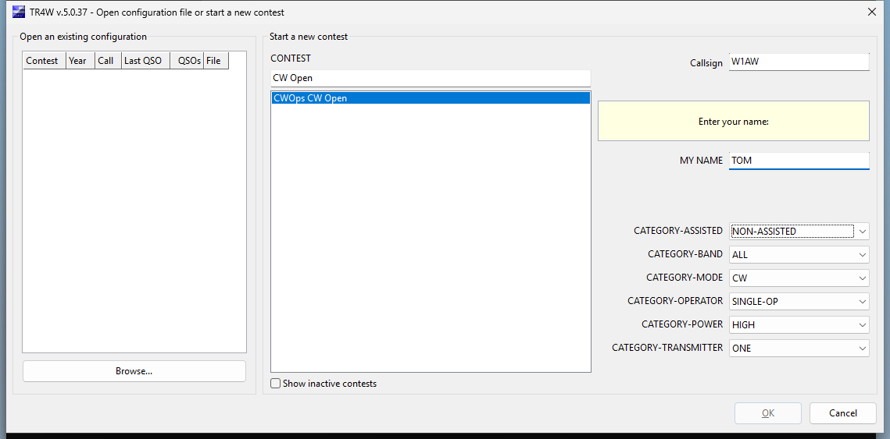
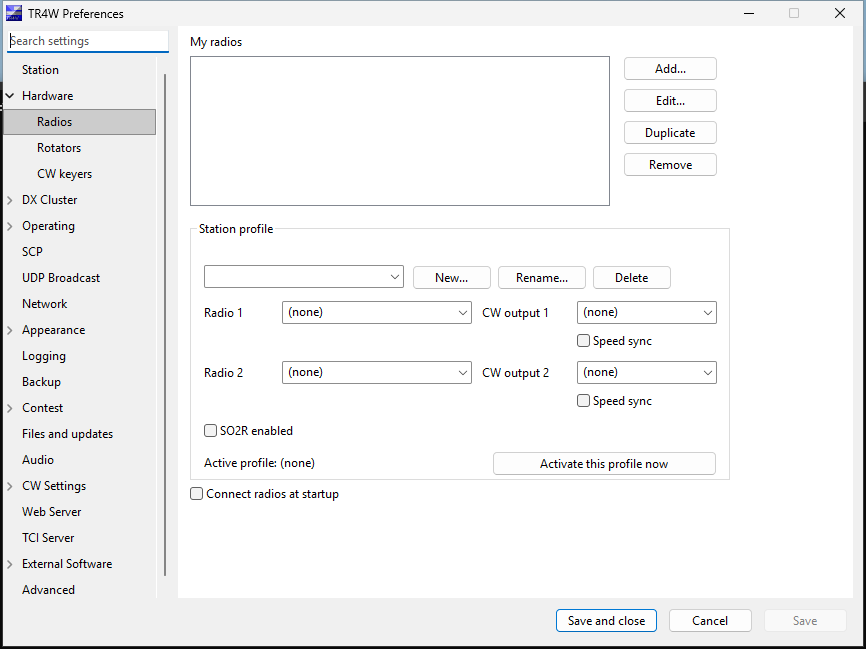
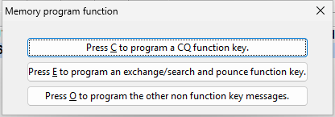
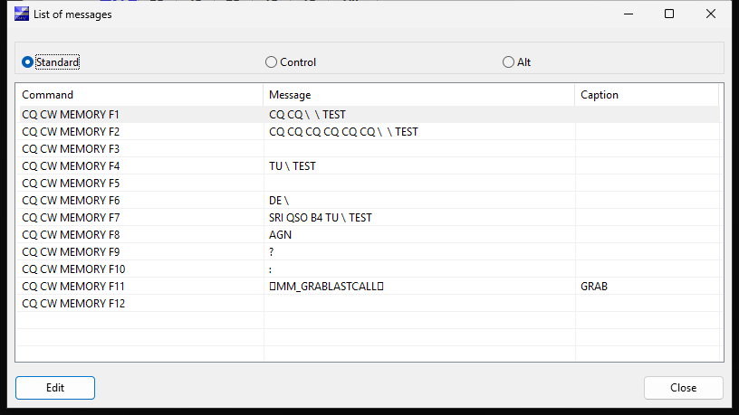
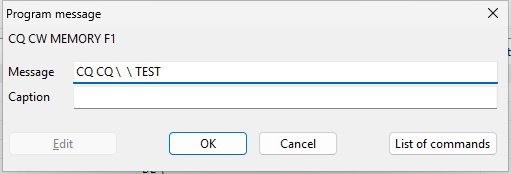
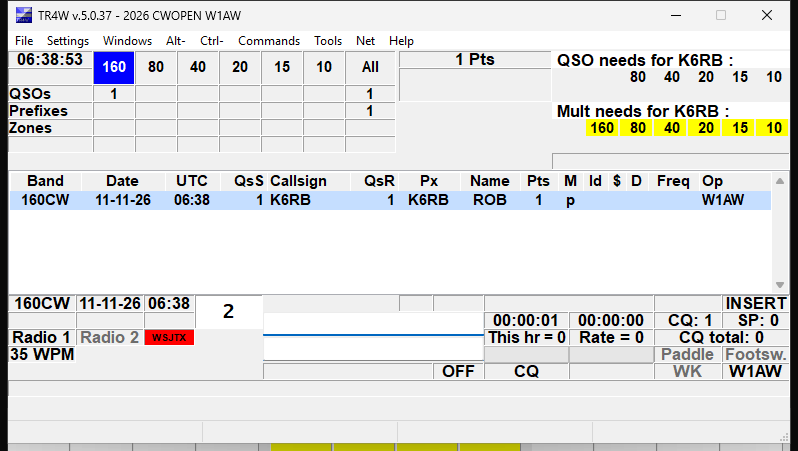

# CW Open and CWT with TR4W

Based on **The CW Open and TR4W**, Marvin Bloomquist, N5AW (2011). Updated for TR4W by Tom Schaefer, NY4I, November 2026.

This edition keeps Marv's practical approach: configure a small station, learn the messages, and practise before the event. It replaces the older menu and CFG-file procedures with the current application. Screenshots come from the Windows GUI-test VM running **TR4W 5.0.37**. W1AW/TOM and any contacts shown are practice examples, not an operating log. Other platforms and later builds can differ. The [operator guide](https://tr4w.github.io/TR4W-D12/) covers broader station setup.

## 1. Choose the right activity

**CW Open and CWT are different events.** Choosing the wrong contest changes exchange interpretation, not just the CQ text.

| Activity | TR4W choice | Exchange |
| --- | --- | --- |
| CW Open | **CWOps CW Open**; internal name CWOPEN | Sequential serial number and name. |
| CWT | **CWops Test (CWT)**; internal name CWOPS | Name and membership number for members; non-members use name and the location information specified in the current rules. |

CW Open has three independently scored sessions, each starting its serial numbers at 1. Keep a separate log for each. Work a station once per band per session and retain dupes. Score each session from valid QSO points times distinct callsigns worked: working a call on another band can add points without adding another distinct-call multiplier. Consult the [CW Open rules](https://cwops.org/cwops-tests/cw-open/) for the event year, times, categories and submission instructions.

For CWT, use the [CWT rules](https://cwops.org/cwops-tests/) and its own exchange. Merely changing CWO to CWT in a CQ message does not select the right contest.

## 2. Install and create a practice log

Obtain the intended 5.x package from [TR4W-D12 releases](https://github.com/TR4W/TR4W-D12/releases) and follow its installation instructions. Earlier manuals and downloads can describe 4.x; check the version you installed.

Use the installer for normal Windows setup. Copying only an executable leaves out required data, libraries and help files. If Windows flags a download, verify its source and investigate the reported problem before proceeding. Do not disable antivirus as a routine installation step.

Start with a practice log separate from any log you will submit. In **Open configuration file or start a new contest**:

1. Under **Start a new contest**, search for **CW Open**.
2. Select **CWOps CW Open**.
3. Enter your **Callsign** and **MY NAME**. Use the name you will send, not a membership number.
4. Review the category selections, particularly CW mode, operator class and power. The screenshot contains example values, not recommendations for your entry.
5. Choose **OK**. Check that the main title identifies CWOPEN and your callsign.

A new contest uses a SQLite database. You do not need to create or edit a legacy CFG file. Use the startup picker or **File → Open Log...** to reopen the intended database. Switching logs can restart TR4W; finish and verify the current contact first.

Locate the current band/mode, outgoing serial, callsign and exchange fields, log rows, score and operating state. No physical radio is connected in this screenshot; a displayed band does not prove a rig is tuned there.

**Multiplier display:** the tested build labels distinct-call multipliers as Prefixes and also displays an irrelevant Zones row. This UI vocabulary is tracked in [issue #277](https://github.com/TR4W/TR4W-D12/issues/277). One valid practice contact produced the expected one point; no scoring failure was demonstrated. The screenshot is not a certification of every scoring case.

## 3. Learn Preferences

Press **Ctrl+J**. Expand the task groups on the left and select their leaves, or search for a setting by name. Hover over a setting for its help where available.

**Save** saves without closing; **Save and close** saves and returns to operating; **Cancel** discards pending changes. Read restart notices rather than assuming every setting applies immediately. The old Save All procedure is not the current Preferences workflow.

Set your station callsign, name and Maidenhead grid to the real operating location. Review the grid when moving the station. Keep practice settings and contacts out of the submitted log.

Use Tab and Shift+Tab to check keyboard navigation. If focus disappears or jumps unexpectedly, record the page and the controls before and after it. Missing explanations and tooltips should be reported; source code should not be required reading for an operator.

## 4. Configure radio control and CW separately

CAT control supplies frequency/mode information. CW keying sends messages. Test these as separate functions.

In **Hardware → Radios**, add a named radio definition. Select the model and its supported serial or network connection. Match serial parameters to the radio; for network control, enter the service address, port and any required credentials. The old guide's K3 values are examples, not universal defaults.

Assign the definition to **Radio 1** in a station profile. Reuse saved definitions instead of re-entering connections for every contest. Select/activate the intended profile, save and follow its connection or restart instructions. Open **Windows → Radio 1** and compare tuning and mode changes against the radio. A visible panel alone does not establish communication.

For a WinKeyer, use **Hardware → CW keyers** to add the device, choose its type and COM port, and assign the intended CW output in the profile. Windows Device Manager can help identify a USB device's port. Do not guess a port that belongs to another station device.

Some radio drivers can send CW through CAT. A network connection alone does not establish that capability. Select one intended sending method and verify its routing. With two radios, confirm which radio and keying output are active before introducing advanced switching.

The VM has no physical radio or keyer. At the station, use an appropriate safe test arrangement to check short and buffered messages, speed changes, Escape cancellation and radio/output switching. Confirm that stopping a message does not leave the transmitter keyed.

## 5. Program messages for CW Open

Choose **Settings → Program messages** to select CQ, exchange/search-and-pounce, or other messages. **Alt+P** opens the message list for the current context. These are the routes observed in the tested application; an older guide's Tools menu route is stale.

Standard, Control and Alt banks hold the corresponding function-key memories. CQ and exchange/S&P contexts can give the same key different content. Select an entry and choose **Edit**, checking its command name before changing it.

The editor screenshot shows an existing default CQ message; replace TEST with CWO for your CW Open example and verify it before use.

**Message** holds the content/action sequence; **Caption** labels the button. Changing a caption does not change what is sent. Use the editor's command list for supported expansions rather than guessing macro names.

| Purpose | Example | Check |
| --- | --- | --- |
| CQ | CQ CWO followed by two backslash characters, separated by spaces | Each backslash expands your configured call. |
| Your call | A single backslash character | Sends your station call. |
| Call being worked | @ | Expands the current worked call. |
| Exchange | # TOM | Replace TOM with your name and verify the selected serial. |
| Acknowledgement | TU followed by a backslash | Thanks and your own call. |
| Request a repeat | AGN? | Assign a convenient repeat key. |

These are starting examples, not universal key assignments. CW Open does not exchange an RST; do not copy a 5NN exchange from another contest. Leave autosend disabled while learning. Verify both CQ and S&P contexts.

Close TR4W normally and reopen the practice log to check message persistence. The automated editor captures are not an RF/keyer test; the VM does not validate transmitted timing or audio.

## 6. Practise contacts and corrections

### Answering a CQ

Select S&P operation and enter the station you hear in the callsign field. Check the dupe indication, then send your call with the S&P message you have verified.

When answered, copy the station's serial and name into the exchange field. For example, a station sending serial 17 and name ROB is recorded with 17 and ROB. Any prefilled name is a suggestion, not proof of what was sent.

Send your serial/name exchange and complete the QSO with the logging action you rehearsed. Check the new row's call, UTC, band/mode, received serial/name and sent serial. **Ctrl+Enter** logs without CW; it still writes an actual contact, so practise in the intended practice database.

### Calling CQ

Select CQ operation and send your CQ message. Enter the answering station's call, send the exchange, and copy its serial and name into the exchange field. Finish with the acknowledgement/logging action you have tested.

If the other station requests a repeat, verify which message and serial will be sent. Do not assume that a repeat key has the old document's meaning. Check serial-decrement/repeat behavior in the practice log before using it on air.

The precise Enter/function-key sequence depends on the selected message banks and automatic-entry options. Learn one ordinary contact before enabling autosend, automatic CQ-to-S&P switching or advanced two-radio commands. Escape stops active CW; additional effects on entry/mode depend on the operating state and settings.

### Reviewing a QSO

Double-click the intended logged contact to open its editor. For an older contact, use **Alt+L** to search and open the matching QSO. Check callsign and UTC as well as the exchange before saving a correction. **Ctrl+L** opens the log view/edit route.

Retain dupes according to the rules. If practice contacts were logged in the wrong database, stop and identify the affected records before changing anything. Deleting records to improve a displayed score can remove information needed for log checking.

### A no-CW rehearsal in CQ mode

In the isolated VM, the following sequence produced a logged contact without CW output:

1. In the clean CW Open practice log, enter K6RB in the callsign field.
2. Press **Ctrl+Enter** to advance the contact without sending CW.
3. Enter **1 ROB** in the exchange field.
4. Press **Ctrl+Enter** to complete the contact.
5. Verify the new row, received serial 1, name ROB, next outgoing serial 2, and one-point total.

These are test values, not a report of a real contact. In the main logging window, **Ctrl+A invokes keyboard CW**; do not use it as a select-all shortcut for the callsign field. Other text-editing dialogs may handle that key differently.

## 7. Keep the three sessions separate

Do not copy CWOPEN.CFG or move all surrounding files as described in the 2011 article. Current contest configuration and contacts belong to a database.

**Same-day filename limitation ([issue #276](https://github.com/TR4W/TR4W-D12/issues/276)):** the tested setup derives a new log's default name from contest, date and call. These are the same for all three sessions on one date. Another creation can therefore encounter an existing log. Never approve an overwrite prompt on a database containing contacts you need.

For a conservative preparation procedure, close TR4W after creating an empty CWOPEN log, preserve a backup, and give that closed database a distinct session filename before creating the next one. Use clearly recognizable names ending in session-1, session-2 and session-3. Reopen each exact file through the picker/Browse and verify its identity, zero contacts and starting serial before the event.

Do not rename an open SQLite file or copy only its main database while active: committed data can be in a WAL sidecar. Use TR4W's backup command for an open log. After an abnormal close, preserve the database and matching sidecars rather than guessing which files to discard.

Check messages and categories in each session. Reusable station radio definitions do not prove that a newly created contest inherited every message you intended. A clear session selector or same-day-log naming workflow would be better than manual filename management; track the issue rather than treating the workaround as the final design.

## 8. Add useful operating windows

The **Windows** menu offers the band map, dupe sheet, function keys, SCP and radio panels. Start with the main window and add only the displays you need.

SCP/possible calls help with uncertain copy but do not establish the transmitted call. A band-map spot is not a logged contact. Check tune-from-spot behavior with your radio before relying on it. For CW Open, use the distinct-callsign multiplier rule rather than interpreting a generic zone/country display as the contest's rule.

Choose assistance/category options consistent with the current sponsor rules and how you actually operate.

## 9. Back up, export and submit

Press **Alt+F** to create a local log snapshot and read the result. An external destination is optional; a background copy elsewhere has its own completion status. Keep a recovery copy separate from the operating database.

After each CW Open session:

1. Verify the session database, UTC range, band/mode, serials/names, station call and category. Review the score against the rules.
2. Use **File → Export → Cabrillo** and inspect the station/category information and QSO lines.
3. Retain a separately named submission file for this session. Follow the sponsor's current session-numbering and filename instructions.
4. Submit through the sponsor's designated route and retain the acknowledgement. Generating a file does not submit it.
5. Export ADIF separately if needed for another logger. Current exports use the database's basename and output extension beside the log; inspect the actual path instead of assuming the old per-contest-folder layout.

For CWT, follow its current score-reporting instructions, not automatically the CW Open submission procedure.

## Before going on air

With transmission safely inhibited, rehearse a complete practice contact. Verify the right log and station identity, correct exchange, band/mode, message banks, serial behavior, cancellation, backup and reopening. Begin the event in its clean session database.

For support, provide version, platform, contest, exact steps and a screenshot. Use the current project support links; this update does not renew personal email/support commitments from the historical article.

## Evidence and review limits

The original is preserved as **TR4W-for-CWOPS-D7.md**. Repository-relative screenshots replace the MarkText-profile links. Repeatable Python scenarios and environment/build evidence are under **tools/gui_test/**; the screenshot plan lists additional guide coverage.

The isolated VM verifies the specific recorded UI actions, not physical keying, sponsor acceptance or every scoring path. Unverified station/on-air steps above require operator rehearsal. Sponsor pages checked in November 2026 may still describe the 2026 running: check the rules announced for your event year.

Application defects and unresolved UI explanations belong in issues with reproduction evidence. Staging omissions and automation failures are recorded separately and are not presented as TR4W defects.
