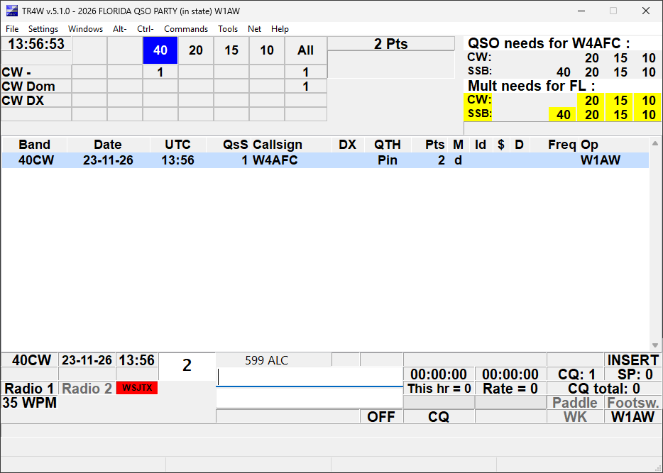
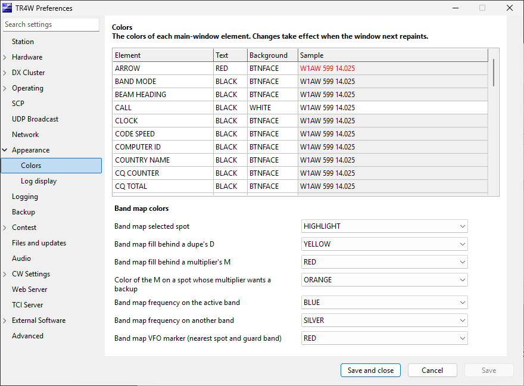

# Main window and appearance

## Read the main window

This Florida QSO Party practice log shows TR4W 5.1.0 after one contact on 40 m CW. The contest determines which columns, totals, and exchange details you see.

1
2
3
4
5
6
7
8

| Area | What to read |
| --- | --- |
| **1. Totals and score** | The upper-left table breaks down contacts and multipliers by band. The highlighted heading is the current band. The score is next to the totals. |
| **2. QSO and multiplier needs** | The upper-right strips show which band and mode combinations still need the displayed station or multiplier, according to the contest rules. Here they refer to W4AFC and Florida. |
| **3. Editable log** | The center lists saved contacts. The example shows W4AFC on 40 m CW with the received QTH PIN, the points, and the logging operator. |
| **4. Station and timing** | The lower left shows band and mode, the UTC date and time, radio selection, and CW speed. |
| **5. Next QSO number** | The large **2** is the next serial TR4W will assign. Contests that exchange a serial can include this number in the sent exchange. |
| **6. Contact entry** | **599 ALC** is the exchange this station sends. Enter the other station's call in the upper white field and its received exchange in the lower field. |
| **7. Operating counters** | The lower right shows CQ and search-and-pounce contact counts, rate, and operating indicators. |
| **8. Connection status** | The bottom strip shows messages from Radio 1, Radio 2, DX Cluster, and Network. Open their windows for connection details. |

See the [radio panels](radio-windows.md), [band map](bandmap.md), [multiplier windows](multipliers.md), and [DX Cluster console](dxcluster.md) for their own controls.

## Set colors

Open **Settings → Colors**, or **Ctrl+J → Appearance → Colors**. Each row names a screen element. Choose its foreground (text) and background colors from the offered names; the sample shows the combination as you choose it. Apply or save the preferences to use the colors in the operating windows.

Start with the callsign and exchange fields, editable log, dupe indication, and multiplier indication. Keep text readable against its background. Some status colors deliberately override the normal element color—for example, dupe alerts and the active-radio indication. The Colors page is not a replacement for those status rules. WSJT-X highlighting also uses TR4W's configured dupe and multiplier colors when sending highlights is enabled.

## Show more QSOs in the main window

Drag the main window wider or taller. The log, possible-call and status areas use the available width, and the main text scales with width. The sent exchange appears above the call field. Set the font and **Main window text size** in **Preferences → Appearance**. The earlier `ROW COUNT` and `WINDOW SIZE` settings are retired.

**SHOW GRIDLINES** and **NO COLUMN HEADER** apply immediately. **NO COLUMN HEADER** hides the heading row on the log grids and the Network and Stations lists. Hold **Alt** and drag with the left mouse button to move a tool window whose title bar is hidden by **NO CAPTION**.

## Recover a window from a missing monitor

TR4W checks saved positions when opening windows and revalidates open windows after display changes. A window outside the usable displays is moved onto an available monitor. Several recovered windows are staggered so they do not all occupy the same position.

1. Confirm in the operating system's display settings that the disconnected monitor is no longer part of the desktop. A display that the OS still reports as present can still receive windows.
2. Restore minimized windows; the live recovery pass skips minimized windows. Open the desired tool window from **Windows** if it is closed.
3. If necessary, close and restart TR4W with the current monitor arrangement so saved positions are checked again.
4. Move the recovered windows where you want them and exit normally to save the layout.

If a monitor returns during the session, an untouched rescued window can return to its original position. Moving it yourself adopts the new position. Layout now lives in the `windows` section of `tr4w.json`; old advice to delete `tr4w.pos` does not reset the current JSON layout. Do not delete the entire settings file to recover one window. See [settings locations](../start/files.md).

??? info "Source check"
    Earlier manual: “Program Windows — Names and Colors.” Current implementation: `uPrefsForm` color grid and `SaveColorRows`, `uMainForm` resize anchors, `MainUnit.EnsureRectOnScreen`/`RevalidateOpenWindowsOnScreen`, and `uWindowLayoutStore`. Monitor recovery is code-reviewed here, not tested on physical displays.
