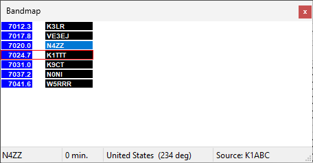
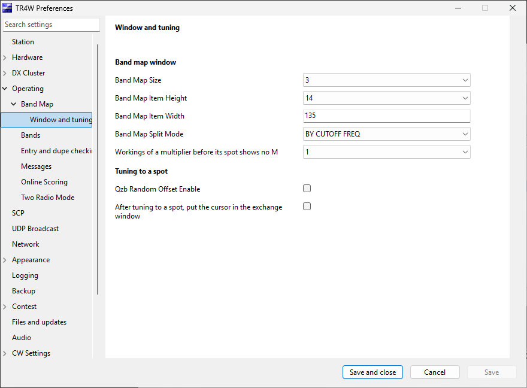
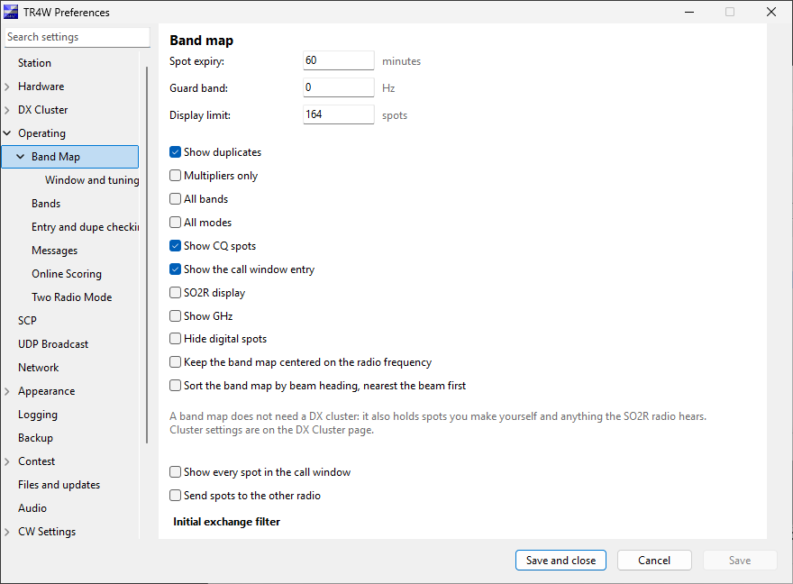

# Use the band map

The band map organizes spots by operating frequency so you can find stations to work. Its contents depend on incoming spots, age, contest state, and display filters.

## Find and select a station

Open **Band map** from the Windows menu. Connect a [DX cluster](dxcluster.md) or use another configured spot source. Select a spot to inspect it; double-clicking invokes the tune-to-spot action.

Each row shows a frequency in kHz and a spotted callsign. In this practice feed, the blue selection is **N4ZZ** on **7020.0 kHz**. On the bottom line you can read its age, country and beam heading, and the spotting station. The outline around **K1TTT** marks the spot nearest the radio's **7025.0 kHz** frequency.

In a two-radio setup, double-click behavior can target the inactive radio when the corresponding SO2R setting is enabled and both radios have frequency information. The context menu also offers **Send spot to inactive radio**. Verify which radio moves before relying on this during a contest.

Tuning to a spot does not complete or log a contact. Confirm the station's callsign and exchange on the air.

## Worked-multiplier target

Open **Ctrl+J → Operating → Band Map → Window and tuning** for the **Workings of a multiplier before its spot shows no M** setting.

**BAND MAP WORKED MULT LIMIT** accepts **1–9**, with **1** as the default. An orange **M** marks a multiplier already worked fewer times than your chosen target. **MULTS ONLY** keeps those spots visible. Sweepstakes counts a section across bands and CQ WW counts the relevant multiplier per band.

A spot needs usable multiplier information, such as a section or state in the cluster comment. Tuning to a spot does not count it as worked; logging the contact changes the count.

## Control what you see

Open **Ctrl+J → Operating → Band Map** for spot expiry, display limit, and the main filters.

Right-click the map for its display controls:

| Control | Purpose |
| --- | --- |
| BAND MAP ALL BANDS | Include spots outside the current band. |
| BAND MAP ALL MODES | Include other modes. |
| BAND MAP DISPLAY CQ | Control display of CQ entries. |
| BAND MAP DUPE DISPLAY | Control whether already-worked stations remain visible. |
| BAND MAP MULTS ONLY | Limit the view to spots classified as multipliers. |
| BAND MAP SO2R DISPLAY | Adjust the two-radio display behavior. |
| Hide digital spots | Filter digital spots from the map. |
| Center on radio frequency | Center the frequency-ordered view around the radio. |
| Sort by beam heading | Sort spots by heading. Centering is unavailable while this sort is active. |
| Text size | Enlarge, shrink or reset band-map text independently of the main window. **BAND MAP SIZE** accepts **−4 to 12**. |
| Delete selected spot / Remove all spots | Remove spot entries, not contacts from the contest log. |

**BAND MAP DISPLAY LIMIT** caps how many spots can display within the available space. The map follows the active radio's band and mode. The nearest spot has an outline, and a spot within the guard band uses the VFO marker color for its frequency. Set the spot, selection and marker colors in **Preferences → Appearance → Colors**.

Enable **BAND MAP CLICK GOES TO EXCHANGE** if you want a single click to move keyboard focus to the exchange field. Its default is off.

Spot decay limits how long entries remain useful. [BAND MAP DECAY TIME](../reference/commands/a-d.md#band-map-decay-time) is used as minutes by the display's age calculation. A station can leave the frequency before the spot expires.

## Why a spot might disappear

Check band/mode filters, the mult-only filter, dupe visibility, and age before diagnosing a connection failure. A contact you just logged can change how its spot is classified. Compare the raw cluster console with the filtered map to separate reception from display.

## How the display stays separate from the data

The spot list owns the spot data; the LCL form owns selection, filtering, and painting. The view requests refreshes through a small interface, with refresh work coalesced by the timer rather than treating every incoming spot as a separate full redraw. This keeps the display and incoming-data processing distinct.

??? info "Evidence and review status"
    Current controls and tuning behavior: `ui/lcl/uBandMapForm.lfm` and `.pas`. Data/view boundary: `uBandMapView.pas` and `uSpots.pas`. Band-map design history (`docs/BANDMAP_LCL_DESIGN.md`) supplies rationale but predates the implemented LCL form. Two-radio behavior and colors need a running-build walkthrough.
