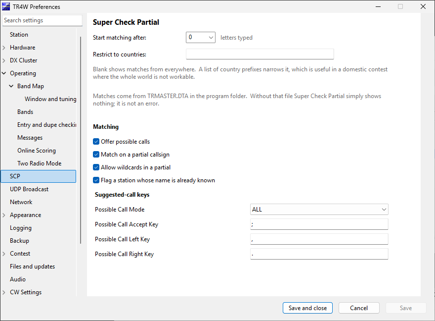

# Possible calls and Super Check Partial

Call assistance offers candidates when you copy an incomplete or uncertain callsign. It does not establish what the station actually sent. Confirm the call on the air before logging it.

The older manual distinguishes three related tools:

| Tool | Purpose and data |
| --- | --- |
| Partial calls | Matches partial input against calls available from the contest's dupe/initial-exchange information. `PARTIAL CALL ENABLE` controls this feature; `WILDCARD PARTIALS` controls whether the fragment must start the call. |
| Possible calls | Suggests similar calls. `POSSIBLE CALLS` enables the candidate strip; `POSSIBLE CALL MODE` controls the candidate source/filter. |
| Super Check Partial (SCP) | Searches the master callsign data for a fragment. `SCP MINIMUM LETTERS` controls automatic activation; `SCP COUNTRY STRING` restricts the countries included. |

Open **Ctrl+J → SCP** to set the matching threshold, choose countries, or change **Possible Call Mode**. The current mode defaults to **ALL**. See the [command reference](../reference/commands/index.md) for setting names and accepted values.

## Contest call history

Enable **USE CALL HISTORY FILE** and choose **CALL HISTORY FILENAME** in Preferences to use an N1MM-format history file. For Sweepstakes, a call not already known in the local log can prefill its check and section. With no filename set, the defaults are **SSCW.txt** for CW and **SSSSB.txt** for phone. A partial history row can prefill the fields it has. Always confirm the received exchange on the air.

**Help → Download call history for this contest** downloads supported files on demand, including for Sweepstakes, several other ARRL contests, CWops events, NA Sprint, and many QSO parties. TR4W applies a successful load live. A failed load leaves the previous history in use. If you configured a custom filename, confirm the path in the completion message.

## Use the possible-call strip

Enter the call or uncertain fragment. **Ctrl+P** requests possible-call processing (and the associated short-path rotor action if configured). With the default keys, **comma** selects left, **period** selects right, and **semicolon** copies the selected call into the callsign entry field. The three keys are configurable. Selection alone does not log a contact.

The current strip uses bold selection and red/white dupe cells rather than relying on the old manual's angle-bracket cursor illustration. It clears when there are no candidates, so a previous result should not be mistaken for the current search.

## Maintain the master data

Use [Download TRMASTER.DTA](../start/data-updates.md) and check the completion message. The new data is available after a successful load. An empty result can mean no match, a country filter, a minimum-character threshold, or missing master data. If enabled, **ENFORCE VALID CALLSIGN** separately checks the base call against the loaded country file before logging.

??? info "Source check"
    Earlier reference manual and wiki configuration statements for partial/possible calls and SCP. Current: `trdos/logedit.pas` (`DoPossibleCalls`, `SuperCheckPartial`), `trdos/logscp.pas`, `uSettingsModel`, and `MainUnit` candidate-key handlers. The current default keys are `,`, `.`, and `;`.
