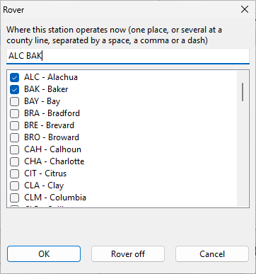

# Contest additions and rule checks

Search the new-contest picker by part of the event's name. Read the event information and supply the operating area, category, and exchange requested for that contest. Existing logs can still open when an older event is hidden from the new-contest list.

## Contest additions through 5.1.0

5.1.0 adds **RUS-WW-DIGI** and the **Weekly RTTY Test (WRT)**. See all [29 contests added since 4.x](../features-since-4.md#contests-added-since-4x) and the [full 5.1.0 contest list](../reference/contests.md). The combined **IN7QPNE** choice is for stations outside the participating areas.

Canadian Prairies is scheduled for the second Saturday in May at 17:00 UTC for 10 hours. The Atlantic Canada multiplier list uses 47 counties and divisions. Check the sponsor's schedule before the event.

- **Winter Field Day 2027** counts QSO points. Apply the objectives bonus at submission. TR4W excludes 12, 17, 30, and 60 m for this event.
- **ARRL Sweepstakes** stores contacts in the wrong mode as rule-derived X-QSOs. FM does not qualify as Sweepstakes phone. In contests that exchange the year first licensed, such as EUHFC and KVP, enter **MY LICENSE YEAR** in the appropriate station or contest field.
- **QSO parties** use contest-specific modes and scoring. Florida, Ohio and 7QP refuse FM. Indiana and Salmon Run accept CW and phone. Florida has contest-specific overlay and station categories. Check the sponsor's rules for mobile and rover bonuses and any manual claim.
- **Vermont QSO Party** uses `vtqp_club_stations.txt` with a `YEAR` line for the yearly club multiplier list. Eligible digital contacts can produce a separate `-ft.adi` export.
- **RU3AX Memorial** now uses a grid exchange. Older logs lacking grids can rescore to zero under the new rules.

## Operate as a rover

Type `ROVER` in the call field and press **Enter**, or choose **Tools → Commands → ROVER**. Select or enter your operating place or places and confirm. The dialog applies the contest's county-line limit. Watch the **ROVER** panel when moving, and use the same dialog to turn roving off.

At a boundary, one contact creates linked rows for the selected places. Dupe checking includes the place you sent from. Set your sent messages with [`{ROVERCALL}` and `{ROVERQTH}`](../station/cw-messages.md#message-commands) where appropriate. Review [the export](../log/export.md#current-export-details) before submitting a rover log.

## Entering the exchange

Type the exchange as it is sent on the air, words separated by spaces. When TR4W knows a typed code is not valid for the contest, for example a district, state or section the contest does not list, or a CQ zone above 40, it refuses the entry and says why on the status line. Correct the word and press Enter again. Not every contest's parser names its reason yet; with the standard QSL mode, a refusal without a message still means the entry was not logged.

With [QSL MODE](../reference/commands/q-s.md#qsl-mode) set to QSL AND LOG, a refused entry is still logged. A refused zone is not written to the contact, but the exchange text is stored with the contact as typed, so the zone can be corrected afterwards.

RSGB IOTA references may be typed with or without the dash: `EU-005`, `EU005` and `EU-5` are all logged as `EU-005`. Only a dash straight after the continent is accepted.

## Check before submission

Confirm the exchange, multiplier totals, eligible bands and modes, and category. TR4W stores the contest's X-QSO decision separately from your manually set X-QSO flag. Edit QSO shows a rule-derived X-QSO as checked and disabled. **Rescore Log** recomputes the rule result using the current contest rules. Grid-based contests require the applicable grid information.

TR4W records station facts with each QSO, including applicable own-call, location, and zone information. Review these when operating from more than one location; changing today's station settings is not a substitute for correcting an earlier contact.

Export and inspect [Cabrillo or ADIF](../log/export.md), then follow the sponsor's submission instructions.

??? info "Review boundary"
    Based on `RELEASE_NOTES.md`, `CHANGES.md`, the contest registry and the individual 5.1.0 contest definitions. Check the sponsor's submission instructions for your event.
