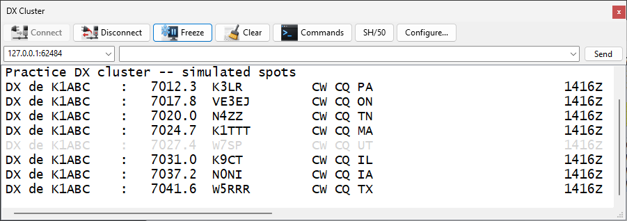
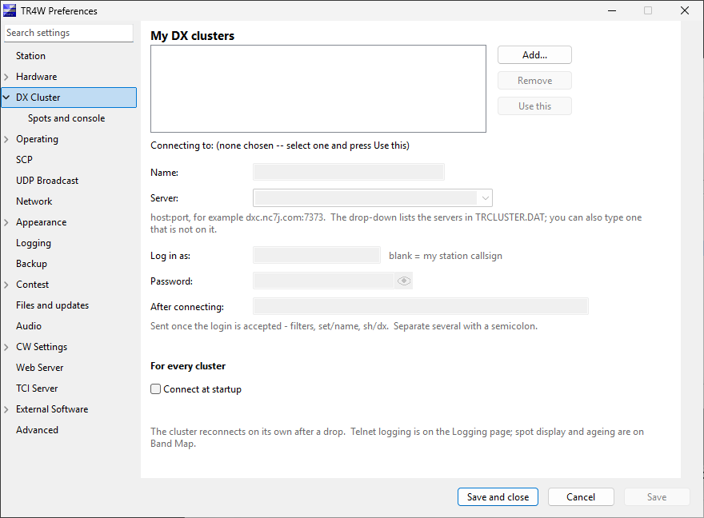

# Connect a DX cluster

The main-window status strip now shows the DX Cluster connection state even with the console closed. It identifies the subsystem; open the cluster window for the host and detailed messages.

The cluster console shows the node's messages and lets you send commands. Parsed DX spots feed the [band map](bandmap.md), where contest and display rules determine what you see.

## Connect and check reception

1. Choose **Windows → DX Cluster**.
2. Use **Configure...** to review the cluster connection, then select the intended node.
3. Choose **Connect** and follow any login prompts from that node.
4. Confirm that node messages arrive. Use the command-entry field and **Send** for a command appropriate to the node.
5. Compare a received spot with the band map. If the console receives it but the map does not show it, review the map filters and spot age.

The form also provides **Disconnect**, **Freeze**, **Clear**, **Commands**, and **SH/50**. Command support and response syntax depend on the cluster node; a button's presence does not make every server understand that command.

The host selector is at the left below the toolbar. Enter a node command in the field beside it. In the first spot from this local practice feed, **K1ABC** reported **K3LR** on **7012.3 kHz** with the comment **CW CQ PA**. The timestamp at the right is UTC. The [band map example](bandmap.md#find-and-select-a-station) uses the same feed.

**Configure...** opens **Preferences → DX Cluster**. Use **Add...** to enter a host and port, or choose a server from the supplied list.

Recognized `SH/DX` history replies can also populate the band map. Their age comes from the UTC time in the reply.

## Self-spot from the run frequency

Choose **Control → Self-spot** or put `{SPOTME}` in a [function-key message](../station/cw-messages.md#message-commands). TR4W supplies your callsign, run frequency, and contest name. It checks the contest's self-spot rules, run state, frequency, and cluster connection before sending.

**CLUSTER AUTO SELF SPOT** is off by default. When enabled, **CLUSTER SELF SPOT INTERVAL** accepts 1–240 minutes and defaults to 10. A contest can require a longer minimum. Check the notice if a manual self-spot is refused.

## Freeze, clear, and history

**Freeze** lets you hold the console view for reading; it is not the Disconnect command. **Clear** concerns console content, not the contest's QSO database. Use the controls for their displayed purpose rather than using console visibility as a connection-status test.

The current code separates the visible console-line budget from the session trace. [TELNET CONSOLE LINES](../reference/commands/t-z.md#telnet-console-lines) bounds the displayed history; it is not a promise that the session archive is limited to the same number of lines.

## Troubleshooting

| Symptom | First check |
| --- | --- |
| No connection | Selected host/port, reachability, and the node's availability. |
| Connected but no useful spots | Login, node-side filters, and the node's supported commands. |
| Console has spots but the map appears empty | Band, mode, mult-only, dupe, and age filters. |
| Old console lines are no longer visible | Console-line budget; consult the session trace when diagnosing history. |

A spot is information from another source. It can contain an incorrect call, stale frequency, or misleading comment. Verify it while operating.

??? info "Evidence and review status"
    UI: `ui/lcl/uTelnetForm.lfm` and `.pas`. Transport: `uDXClusterClient.pas`. Spot ingestion: `uTelnet.pas`, `uDXSpotParse.pas`, and `uSpots.pas`. Session logging: `uTelnetTrace.pas`. This page has not connected to a live cluster for validation.
