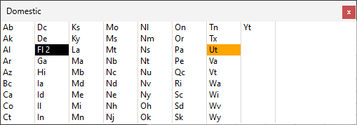
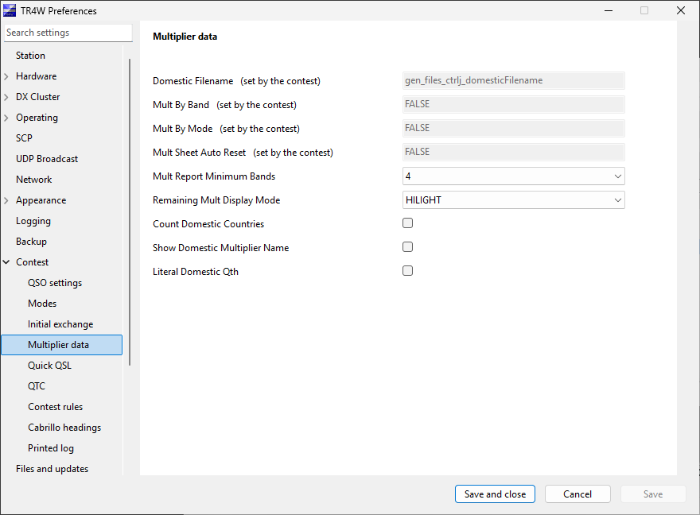

# Read the multiplier windows

Multiplier windows answer “which multipliers have I worked, and which do I still need?” for the selected contest context. A multiplier is not the same as a new callsign: a new station can belong to a country, zone, or section you have already worked.

## Choose the relevant view

TR4W has a **Remaining mults** window and fixed views for DX, domestic, zone, and prefix multipliers. The general window follows the selected remaining-multiplier type; the fixed views keep their own type.

| View | What its entries represent |
| --- | --- |
| DX | Country/prefix identifiers from the country data. |
| Domestic | The contest's domestic multiplier list, such as sections or other defined areas. |
| Zone | Zone numbers for the active multiplier rules. |
| Prefix | Prefix multiplier entries. |

Only the multiplier categories used by the contest are meaningful. A view's existence does not imply that category counts in every event.

## Understand worked and needed status

The display resolves each entry against current multiplier state when painting. Worked status is evaluated with band and mode context and the contest's multiplier rules; a multiplier worked elsewhere may still be needed on this band.

[REMAINING MULT DISPLAY MODE](../reference/commands/q-s.md#remaining-mult-display-mode) controls which entries appear. In 5.1.0, an unworked multiplier is plain, a worked multiplier is black with white text, and a multiplier that still wants a backup is orange by default. A count appears from the second working. Use **Preferences → Appearance → Colors** to change **BAND MAP WORKED MULT COLOR**, the backup-needed color shared with the band map.

Open this view from **Windows → Mults → Domestic**. The Florida QSO Party practice log uses a target of two contacts per multiplier. **Fl 2** has met the target, **Ut** has one contact and still needs a backup, and plain entries such as **Ga** are unworked.

[SHOW DOMESTIC MULTIPLIER NAME](../reference/commands/q-s.md#show-domestic-multiplier-name) uses the longer alternate domestic name when one is available, otherwise retaining the ordinary entry label.

Find both settings in **Ctrl+J → Contest → Multiplier data**.

## Check a surprising result

1. Confirm the contest, current band, and mode.
2. Check the logged contact's call and exchange.
3. Confirm that the contact represents the multiplier category being displayed.
4. Compare the multiplier window with the log and score state after the display refreshes.

The window is a view of the program's multiplier calculation, not an independent validation of the contest rules. [Test methodology](../theory/testing.md) explains how multiplier and export behavior are checked.

??? info "Evidence and review status"
    `ui/lcl/uRemMultsForm.pas` (`MultTypeFor`, `MultsDrawCell`), `uRemMults.pas` (cell resolution), `uMults.pas`, and `uTestMults.pas`. Layout, display modes, and examples in specific contests still need operator review.
