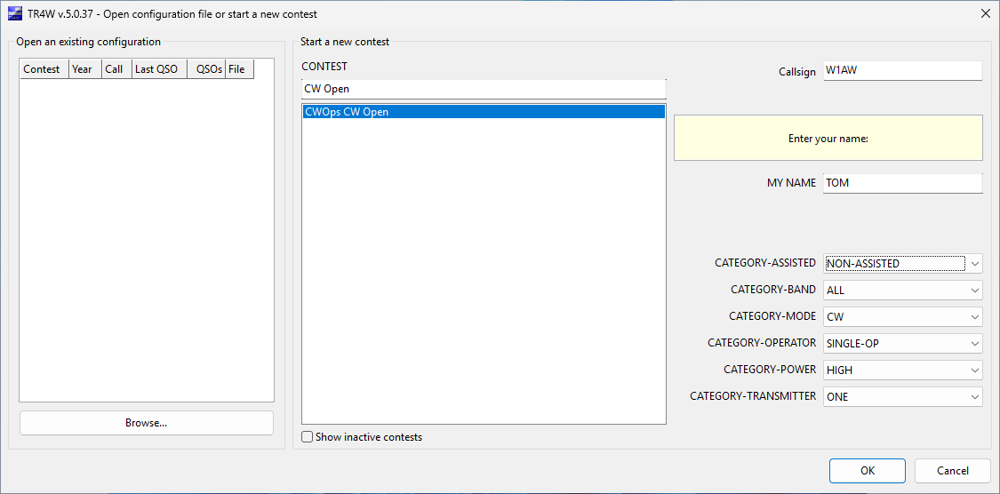

# Open your first contest

Use a practice log to become familiar with TR4W before entering a live contest.

## Complete the initial station setup

On the first launch, the **Setup Wizard** guides you through station details. It also offers radio, WinKeyer, DX cluster, external logger, rotator, and WSJT-X setup. Skip optional equipment or services you do not use. To revisit setup later, choose **Tools → Setup Wizard**, or launch TR4W with `--wizard`.

When the initial setup prompts for your **grid square**, enter the Maidenhead locator for the station's operating location. For example, `FN31` is a four-character locator and `FN31PR` is a six-character locator; use your own location, not these examples. Follow the length requested by the prompt or contest.

Check both your callsign and grid before continuing. You can review or change the grid later in **Ctrl+J** by searching for **MY GRID**. If you operate portable or move the station, check it again for the new location. TR4W uses the station grid for location-based calculations, including headings and distances, and applicable exported station information.

## Create a contest

1. Start TR4W. In **Open configuration file or start a new contest**, find **Start a new contest**.
2. Enter your station callsign in **Callsign**.
3. Search for part of the event name and select it in **CONTEST**. Turn on **Upcoming contests first** to sort by the next known occurrence. Read the event information and complete the requested operating area, county, category, and sent exchange as applicable.
4. Choose **OK**.
5. Check the contest and station information before entering contacts. Configure your [radio](../station/radio.md) if you want frequency and mode information from the rig.

TR4W opens the dupe sheet for a **NON-ASSISTED** entry and the band map for an **ASSISTED** entry, using the contest's `CATEGORY-ASSISTED` value.

The following example shows CW Open setup in the Windows 5.0.37 application. Other contests request different exchange fields.

!!! note "Screen labels"
    The screenshot shows the 5.0.37 layout. The instructions cover 5.1.0. New contests use a database, and translated builds may label the controls differently.

## Reopen a contest

Under **Open an existing configuration**, select a log or use **Browse...**. The recent-log grid shows contest, year, call, last QSO, contact count, and file, with recent activity first. **Last Contest** reopens the most recent contest.

While operating, **File → Open Log** opens the same picker. Selecting a different contest restarts TR4W to load that contest.

The current picker lists contest `.db` files. It also lists a legacy `.CFG` when no corresponding `.db` exists. Opening a legacy contest can start migration; use a copy when evaluating the preview. See [Moving from 4.x](migration.md).

## Check the whole workflow

Before using your station for an event, verify these outcomes in a practice log:

| Check | Expected outcome |
| --- | --- |
| Contest selection | The exchange fields match the event you selected. |
| Station location | **MY GRID** matches the location from which you will operate. |
| Radio tuning | The displayed frequency follows the connected rig. |
| Contact entry | A completed practice contact appears in the log with the expected call, exchange, band, and mode. |
| Reopening | The practice contact is present after closing and reopening the contest. |
| Export | The exported log contains the contact and the expected station information. |

Keep practice contacts separate from the log you will submit.

Continue with [keyboard essentials](../operating/keyboard.md), [backups](../log/backup.md), and [ADIF/Cabrillo export](../log/export.md).

??? info "Source check"
    Labels and selection behavior: `tr4w/src/ui/lcl/uNewContestForm.lfm` and `uNewContestForm.pas`. The checklist is an editorial acceptance exercise, not a report of a completed UI test.
