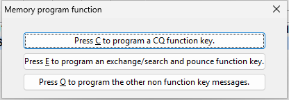
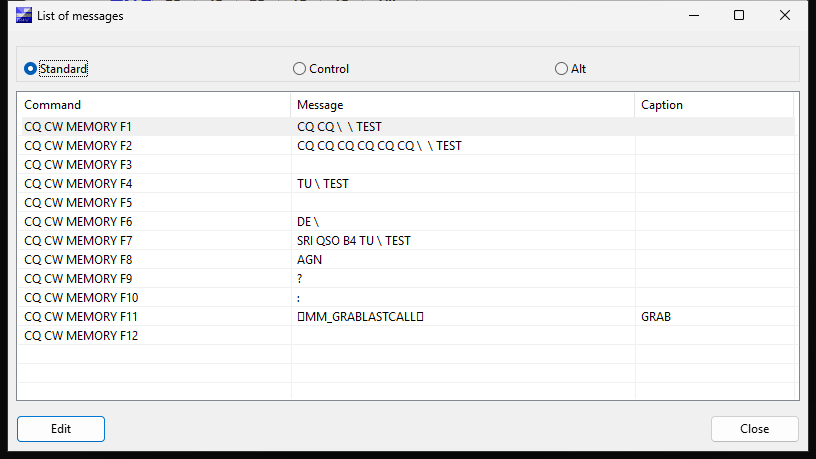
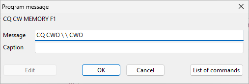

# Program CW function keys

TR4W retains the manual's separate message banks for running and search-and-pounce operation. The same function key can send a different message in each operating context.

1. Select CW and open **Settings → Program messages**.
2. Choose **C** for a CQ function key, **E** for an exchange/search-and-pounce function key, or **O** for other messages.
3. Select the message to edit. Enter the transmitted content in **Message** and a useful button description in **Caption**.
4. Use **List of commands** to insert a supported command rather than guessing its spelling or control-character encoding.
5. Choose **OK** to apply the message. Test the key in the intended CQ or exchange context with the correct radio and [CW sending backend](cw.md). Function-key memories are captured in the contest database when the log closes; exit normally and reopen the practice log to check persistence. Do not edit the `.db` as though it were an old `.cfg` text file.

Alt+P opens the current message list. The chooser, list and editor below show the CW Open examples programmed through the Windows 5.0.37 GUI-test VM on November 11, 2026. No CW was transmitted. Their CWO exchange is a serial and name; CWT instead calls CQ CWT and exchanges first name plus CWops member number, or first name plus state/province/DX country prefix for non-members.

## Start with simple messages

| Message text | Meaning |
| --- | --- |
| `CQ TEST \ \` | CQ followed by your configured callsign twice. |
| `@ 5NN #` | The entered callsign, a CW signal report, and the serial number selected by TR4W's serial-number logic. Use only for a contest whose exchange fits. |
| `TU \` | Thanks followed by your own callsign. |

`\` expands your configured callsign; `@` expands the call being worked; `#` uses the serial-number logic, including configured leading zeros and abbreviated digits. These are executable message characters, so punctuation is not necessarily transmitted literally. A fixed-zone or section contest needs its actual exchange instead of the serial-number example.

Test each bank separately, including the exchange sent by the normal Enter workflow. **Esc** stops CW/automatic-CQ activity through the active sending path. Check the selected radio before testing a message that changes radio focus.

## Message commands

Use braces around a command. The editor upgrades recognized commands saved with the old control-character bookends. A leading `$` inside the braces directs a radio command to the inactive radio.

| Message text | Effect |
| --- | --- |
| `{SPEED+}` | Increase CW speed. |
| `{ALT-D}` | Dupe check on radio 2. |
| `{SPAN=+}` / `{$SPAN=+}` | Widen the panadapter on the active or inactive radio, respectively. |
| `{ROVERCALL}` / `{ROVERQTH}` | Send the roving callsign or place. |
| `{SPOTME}` | [Request a self-spot](../operating/dxcluster.md#self-spot-from-the-run-frequency). |
| `PLS QSY {PASS B}` | Send a CW message with network station B's current frequency in kHz. A station name or band such as `{PASS 14000}` can also select a peer. |
| `{LASTPASSEDFREQ}` | Send the last frequency resolved by `{PASS …}`, for example `14025R5` for 14,025.5 kHz. |

If a required pass frequency cannot be resolved, TR4W displays the reason and skips sending the message. Check the radio and the [SO2R workflow](so2r.md) before testing a command that changes radio focus.

??? info "Source check"
    Earlier wiki SO2R tips and reference manual message concepts. Current chooser/editor: `uProgramMessageForm`, `uEditMessageForm` (`SaveToConfig`), and `uMessagesListForm`; expansions: `trdos/logsend.pas`; stopping: `MainUnit.Escape_proc`. These examples have been checked against code, not transmitted on a radio.
