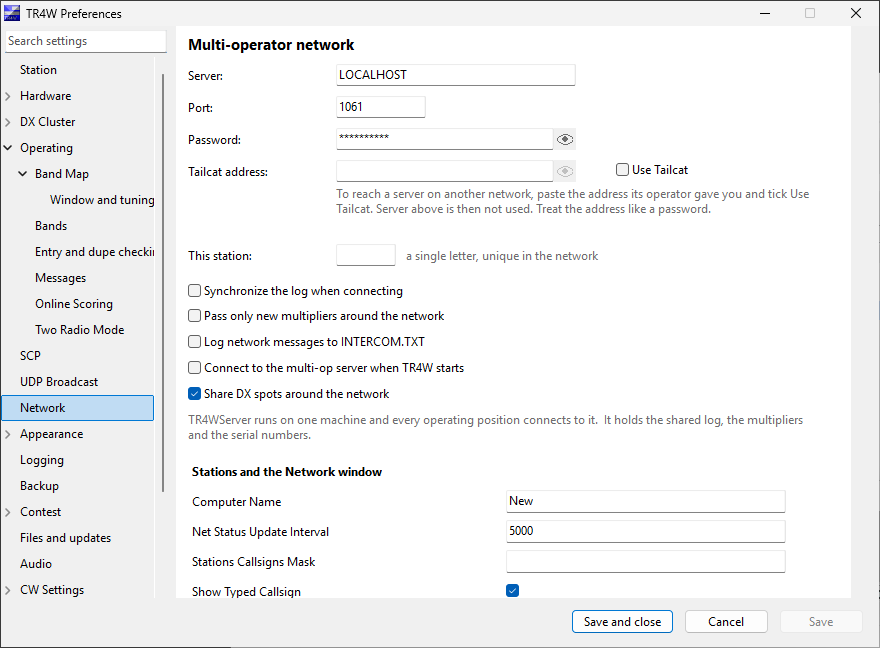

# Multi-station networking

!!! warning "Upgrade the server and all stations together"
    TR4W 5.1.0 uses **protocol 5**. Earlier clients and servers cannot join a protocol 5 network. For TR4WServerPy, use a build that explicitly supports protocol 5. A different application build on the same protocol can connect and may show a version notice.

Protocol 5 creates a server database named `SERVERLOG.tr4wsrv`. Preserve the old `SERVERLOG.TRW` and the contest databases from every station before upgrading. The server leaves the old file in place and starts with an empty database. Reconnect each station to restore the contacts it originally logged through catch-up.

On macOS, obtain `tr4wserver` from the matching `.dmg` or `.tar.gz` when the Mac will host the network. The `.pkg` installs the desktop application only. Open the Network window for details about the main-window Network indicator.

TR4W stations connect to TR4WServer to exchange contest activity. This network is separate from a radio's network CAT connection, a DX cluster, and WSJT-X UDP traffic.

## Set up a practice network

1. Choose the server computer and run a compatible TR4WServer build for the clients being tested.
2. On each client, select the same contest and set **Server**, **Port**, and **Password** in **Ctrl+J → Network**. For a remote server that provides a Tailcat address, follow [Tailcat setup](#tailcat).
3. Give every station a distinct letter in **This station** (the **COMPUTER ID** setting). The station-status display uses these letters to identify stations.
4. Make the server's main port and its synchronization port reachable. The conventional main port is `1061`; the synchronization port is **main port + 1**, normally `1062`.
5. Choose **Net → Connect**. Check the Network and Stations displays, log a practice contact, and confirm that the other clients receive the contact and station state.
6. Test a disconnect/reconnect and a log mismatch before the event. Preserve each station's test log so you can compare what happened.

Keep each client's database in its own intended location and use the application's network protocol. Do not substitute multiple processes writing one shared SQLite file for TR4W networking.

## Catch up after a disconnect

TR4W compares contacts by their stored identity. It adds contacts missing from the station after taking a local backup. In the other direction, it sends contacts logged at that station that the server lacks. Contacts received from other stations and imported contacts are excluded from that upload. A different contest blocks catch-up.

If there is work to do, TR4W asks before transferring contacts, unless **SERVER AUTO SYNCHRONIZE LOG ON CONNECT** is enabled. The upload notice gives the total and breaks out contacts logged while disconnected from contacts the server lacked. If you rebuilt the server, check the resulting contact count after each originating station reconnects.

## Shared settings

Only designated contest options are shared, including certain scoring, multiplier and QTC settings. Preferences can send changes to connected peers on an explicit save. Connecting does not push an entire settings file. Each station keeps its own band, mode, code speed, CW tone, weight and Farnsworth settings. A checksum detects damaged QSO records. Use a trusted network for direct connections or use the encrypted Tailcat tunnel.

## Tailcat

Tailcat tunnels the contest-log connection between networks. Every client and the server still need protocol 5. A radio, rotator or amplifier uses its own separate remote-control setup.

1. Obtain the Tailcat address privately from the operator of a compatible Tailcat-enabled server. Treat the address like a password.
2. Open **Preferences → Network**, paste the address, and select **Use Tailcat**. Keep the configured TR4W server port and password. TR4W uses the tunnel in place of the direct server address.
3. Connect and verify that both live logging and catch-up work. If TR4W reports that the Tailcat library is missing, check the installed package and matching library before retrying.
