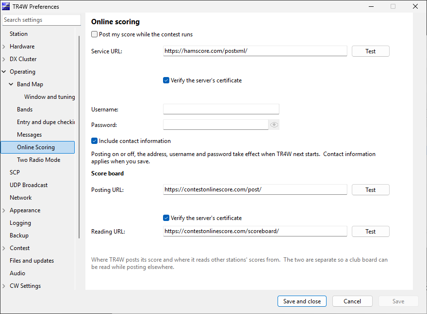

# Post scores to HamScore

The HamScore integration sends live score information and can also send QSO contact data to the configured service. It is separate from exporting a Cabrillo entry and does not submit your contest entry to the sponsor.

1. Open **Ctrl+J → Operating → Online Scoring**.
2. Enable **Post my score while the contest runs**.
3. Set **Service URL**, **Username**, and **Password** for your service account. An empty username falls back to your configured callsign; an empty password prevents the uploader from starting.
4. Decide whether to **Include contact information**. QSO uploads require this setting and a contest marked RTC-capable by TR4W. Turning it off suppresses contact log/edit/delete uploads; score posts remain enabled.
5. Save the preferences and restart TR4W; this page's settings take effect at startup.
6. Open **Windows → HamScore RTC Status** and check the queue and last status. Confirm the result on your scoreboard account before relying on it during a contest.

Normally the worker posts every two minutes. **Push Now** requests an immediate cycle. Unconfirmed contacts remain queued for retry; explicit server confirmation clears them. A growing queue or repeated error needs attention: check credentials, service URL, connectivity, and whether the service accepts the contest. Both radios use the same uploader.

## Check scoring URLs

The default HamScore URL is `https://hamscore.com/postxml/` and the default scoreboard posting URL is `https://contestonlinescore.com/post/`. TR4W updates a saved old default once and preserves a custom URL. Use **Test** next to a URL to check its HTTP response. A 200 response confirms reachability and does not verify an actual score upload. Keep **Verify the server's certificate** enabled for each destination. The global certificate setting controls whether TLS verification can run.

## Rebuild the remote log

**Tools → Re-send Log to HamScore...** and the status window's **Re-send Log to HamScore...** button open the same confirmation dialog:

- **Re-send only** uploads the current contacts with their original IDs, without deleting remote contacts. A QSO deleted locally can therefore remain on the server.
- **Delete and re-send** deletes the server's log for this contest, then uploads the current contacts. The remote deletion cannot be undone, and the scoreboard can be empty or incomplete until the upload finishes.
- **Cancel** leaves the queue unchanged.

Both sending choices request an immediate upload cycle. Confirm the correct contest/account and contact-upload settings before proceeding. Neither choice deletes the local database. Older builds used a different caption and had an incomplete status-window resync action; those instructions no longer describe this source.

A server request for `ResyncLog` is reported for manual action rather than automatically rebuilding. Do not treat the in-memory upload queue as a backup of the local database. See [backups](../log/backup.md) and [diagnostic logging](../log/diagnostics.md) for recovery evidence.

??? info "Source check"
    `uHamScore.pas` worker, configuration and queue helpers; `uPrefsForm.lfm` Online scoring controls; `uHamScoreForm` button handlers; `MainUnit` Tools handler calling both `HamScoreResyncFromScratch` and `SendFullLogToHamScore`. No credentials were entered and no score data was posted while preparing this guide.
