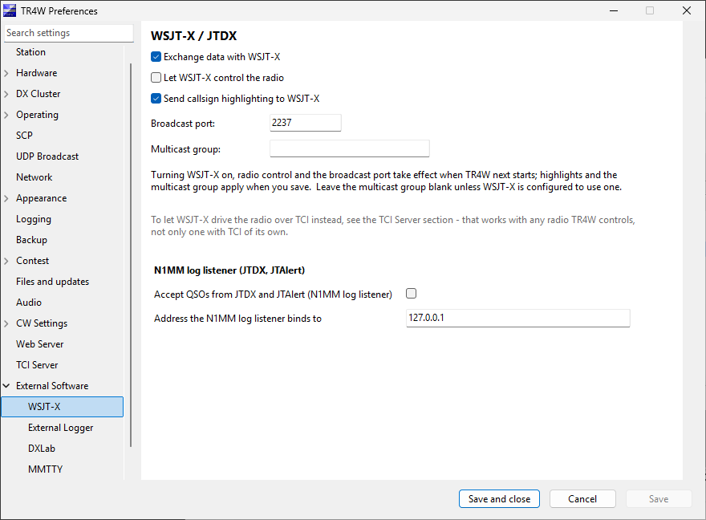

# Connect WSJT-X

WSJT-X performs the digital-mode work. TR4W receives its UDP messages to support contest logging and callsign highlighting.

You can also configure WSJT-X from **Tools → Setup Wizard** during station setup.

## Match the UDP connection

In a practice contest, press **Ctrl+J** and select **External Software → WSJT-X**.

1. Check **Exchange data with WSJT-X** and note the **Broadcast port**. The default is `2237`.
2. In WSJT-X's **Settings → Reporting**, set the UDP server destination and port. For both apps on one computer, the destination is typically `127.0.0.1`. Leave **Multicast group** blank in TR4W.
3. For a shared multicast setup, match the group and port in both apps and select the outgoing interface in WSJT-X.
4. For highlighting, check **Send callsign highlighting to WSJT-X** in TR4W and **Accept UDP requests** in WSJT-X.
5. Save Preferences. Restart TR4W after enabling WSJT-X or changing the broadcast port.

## Verify both directions

Confirm that decoded calls receive the expected highlighting. Then, when you complete and confirm a QSO in WSJT-X, check that it appears once in TR4W with the expected call, band, mode, and exchange.

TR4W can fill a missing state from the received grid when the lookup gives a unique answer. If the grid spans more than one state, it shows the candidates for you to check. Live WSJT-X records use the open TR4W contest.

| If you see this | Check this |
| --- | --- |
| No received activity | Matching port, destination/group, selected network interface, and local firewall rules. |
| Contacts arrive but no highlights | Accept UDP requests in WSJT-X and Send Highlights in TR4W. |
| Duplicate logged contacts | Whether both WSJT-X and another forwarding application are sending the same QSO to TR4W. |

## Radio control is a separate connection

First verify [TR4W's radio connection](radio.md). On the WSJT-X Preferences page shown above, select **Let WSJT-X control the radio**, save, and restart TR4W. Select **DX Lab Suite Commander** as the rig in WSJT-X and point it at TR4W's Commander-compatible TCP service, default port `52002`. Test frequency and mode changes with the intended rig.

## Receive N1MM-style log messages

On the WSJT-X Preferences page shown above, select **Accept QSOs from JTDX and JTAlert (N1MM log listener)** for a sender configured to forward N1MM Logger+ Log messages. The listener is off by default. TR4W listens on UDP `2333` and TCP `52001`. **Address the N1MM log listener binds to** defaults to `127.0.0.1` for senders on the same computer. To receive from another computer, set the listener to this station's LAN address and allow only trusted senders to reach it. Both settings apply when saved. Any sender that can reach the listener can add records to the open contest log.

Choose one forwarding path per sender. A resent contact can be logged and flagged as a dupe. This listener receives contact records and does not provide WSJT-X highlighting or CAT control.

[WSJT-X setting names and defaults](../reference/wsjtx.md)

The [full command reference](../reference/commands/t-z.md#wsjt-x-enabled) includes scope, value constraints, and source initial values. [TCI connections](tci.md) explains the separate radio-control path; [external loggers](external-loggers.md) explains forwarding contacts beyond TR4W.

??? info "Evidence and review status"
    Adapted from the [WSJT-X integration wiki page](https://github.com/TR4W/TR4W/wiki/WSJT-X-Integration), with setting names and defaults checked against `uSettingsModel.pas`. UDP and highlighting behavior still need an operator test with the intended WSJT-X version. The wiki's older instruction to edit `tr4w.ini` has deliberately not been carried forward.
